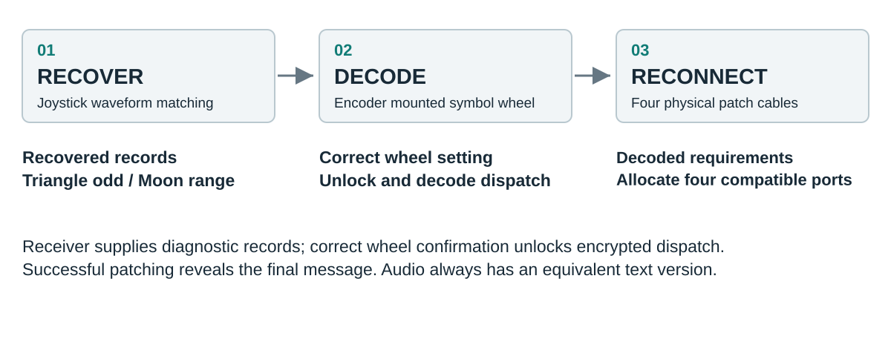
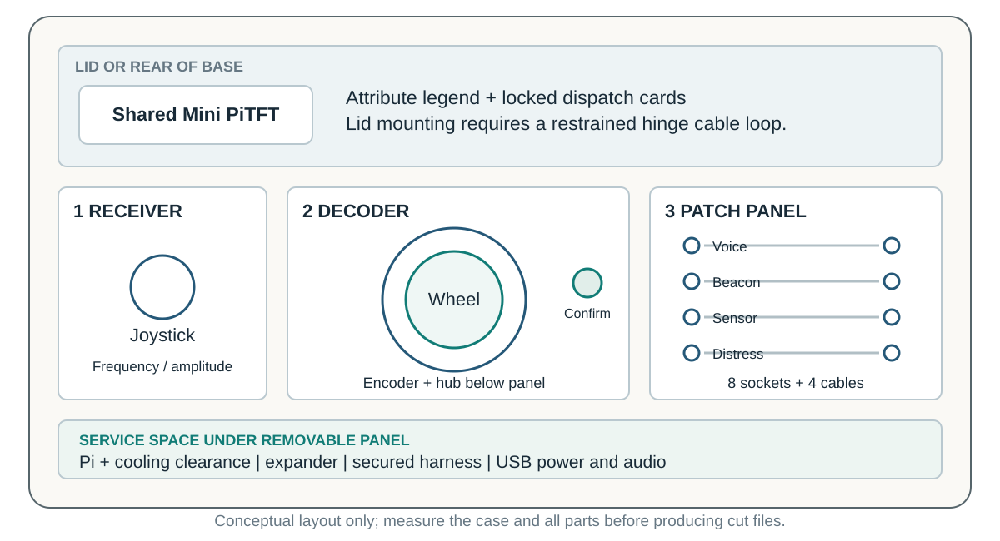
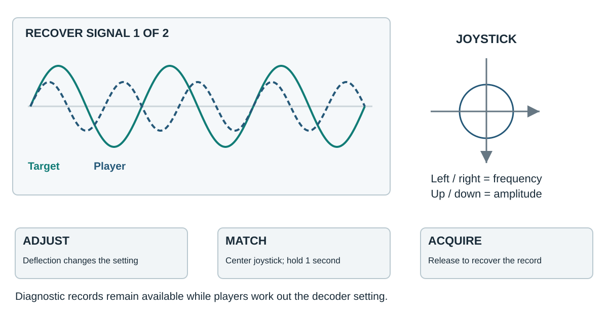
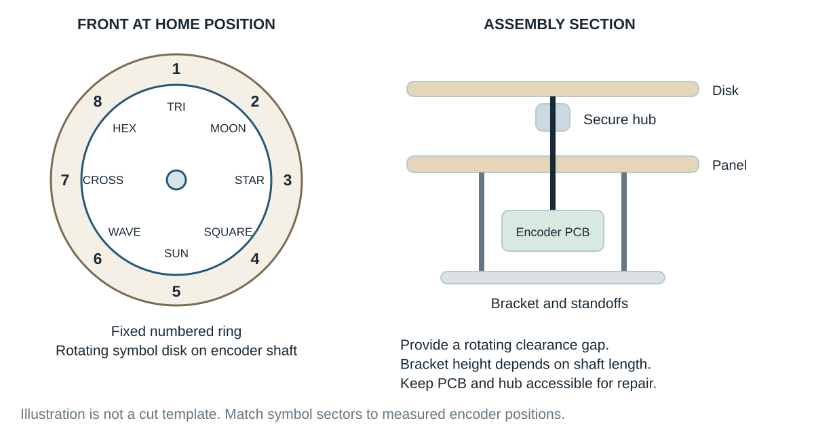
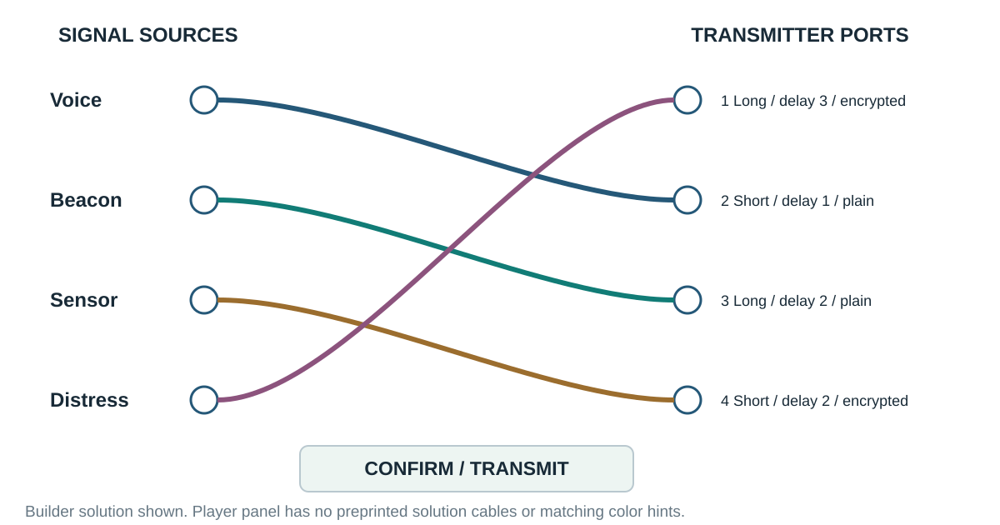
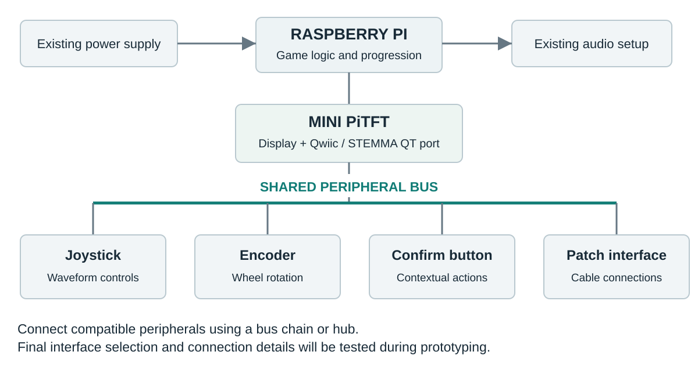
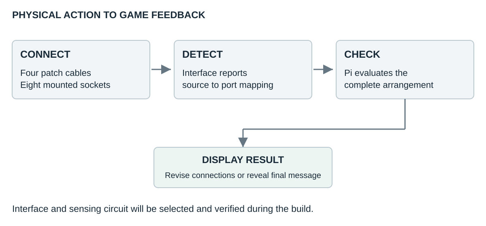

# The Last Transmission Design Document

Escape room in a briefcase | Jonathan Tumalle | Revision 4 | November 16 2026

This design combines waveform matching, an encoder mounted decoder wheel, and a physical cable patch panel. Players recover encrypted source requirements, combine two incomplete diagnostic records to deduce one decoder setting, decode the full dispatch, and reconnect a transmitter to reveal the final message. The document defines the player experience, construction, interfaces, and validation work for this iteration.

See the [current illustrated interaction storyboard](receiver-decoder-storyboard.md) for the complete player walkthrough.

### Scope and current status

Proposed starting scope: one or two players and a 10 to 15 minute session, to be adjusted after paper testing. The design uses external power, one shared screen, and a local Pi process. Audio has readable text equivalents. Automated locks, real radio hardware, and battery operation are optional later additions.

This is a design specification, not a record of a working build. Encoder resolution, mechanical fit, display readability, cable detection, and puzzle difficulty still require testing. The waveform and patch panel are simulations of radio systems, with real physical controls and connection sensing.

Paper test update reported November 18 2026: Jonathan reports that the experiment worked and received positive feedback that the experience made sense. The main feedback concerns the presentation of essential clues in the final design. Keep the current puzzle logic for the first hardware iteration and test clue presentation alongside it. See the [paper prototype feedback record](paper-prototype/test-notes.md).

## Briefcase Setup and Component Placement

Place the three interaction areas on a removable base panel. Mount the display in the base if a lid cable proves awkward; the illustrated lid position is optional. Put the diagnostic records and attribute legend where players can read them while using the wheel. Keep patch cords clear of the disk and joystick.

| Component | Setup and player feedback |
| --- | --- |
| Pi and power | Secure below panel; retain cooler ventilation and access to USB power. Screen reports startup readiness. |
| Screen and speaker | Shared status and reveals; replay recovered text and audio from an on screen archive. |
| Joystick | Mount by PCB holes or a bracket; verify axis direction and center before a session. |
| Decoder assembly | Fixed number ring, rotating disk, secure shaft hub, encoder bracket, and visible home reference. |
| Patch sockets and expander | Sockets fasten to a reinforced panel; harness and scanner stay below. Display acknowledges connection count. |
| Confirm button and clue inserts | One shared Qwiic button changes function by stage; diagnostic records and legend are replaceable printed inserts. |

No final enclosure dimensions are assumed. Measure the actual case, shaft reach, socket rear clearance, screen, cooling height, and cable bend space before generating cut files.

## Puzzle One Waveform Matching

The [working receiver and browser simulator](waveform/README.md) share the same puzzle logic and 240 by 135 display renderer. Physical Pi verification is pending.

The fixed target and adjustable player wave share a phase and baseline. Left or right joystick deflection changes frequency; up or down changes amplitude. Centering stops adjustment and retains settings. Use a dead zone and time based increments so drift and frame rate do not control difficulty.

| Signal | Target parameters | Recovered information |
| --- | --- | --- |
| 1 | 3 cycles across plot; amplitude 0.60 | Voice = Triangle; Beacon = Cross |
| 2 | 5 cycles across plot; amplitude 0.35 | Sensor = Hexagon; Distress = Cross + Moon |

Start the player wave at visibly different settings and allow a forgiving matching tolerance. Require a brief stable match with the controls centered; the working prototype acquires automatically so browser play needs only arrow keys. Tune the sensitivity, dead zone, and matching tolerance with users during prototyping.

Off-target settings remain available for adjustment. After a successful automatic lock, play and display the fragment, then offer the next signal. Matching both unlocks decoder submissions and stores both fragments in the archive. Colored lines also use labels and distinct solid or dashed styles.

## Puzzle Two Decoder Interaction

The receiver supplies encrypted source requirements, not a key or finished instructions. Two physical diagnostic records are placed separately inside the case. Neither provides an exact alignment:

> **Test record A:** The triangle produced an odd-numbered code.
>
> **Test record B:** The moon produced a code greater than 3 and less than 6.

The first record permits Triangle at 1, 3, 5, or 7. The second permits Moon at 4 or 5. Because Moon is the next clockwise symbol after Triangle on the rigid disk, the two records together identify exactly one orientation.

| Candidate | Triangle position | Matches both records |
| --- | --- | --- |
| Moon at 4 | Triangle at 3 | Yes |
| Moon at 5 | Triangle at 4 | No because Triangle must be odd |

Players rotate the wheel to satisfy both records and press Confirm to record their chosen setting. Leave the wheel in place while decoding every symbol. These are player clues; the solution table above is for the design document only.

The fixed ring has numbers 1 through 8 clockwise. The rotating symbols are Triangle, Moon, Star, Square, Sun, Wave, Cross, Hexagon clockwise. Home is Triangle at 1. The deduced setting puts Triangle at 3 and Moon at 4, a 90 degree clockwise turn from Home. At this setting, use the following printed attribute legend to interpret the received dispatch.

| Number | Symbol at this setting | Attribute legend |
| --- | --- | --- |
| 1 | Cross | Long range |
| 2 | Hexagon | Short range |
| 3 | Triangle | Lowest delay |
| 4 | Moon | Encrypted |
| 5 | Star | Any delay |
| 6 | Square | Plain |
| 7 | Sun | Local only |
| 8 | Wave | Offline |

| Received ciphertext | Player interpretation |
| --- | --- |
| Voice = Triangle | Lowest delay |
| Beacon = Cross | Long range |
| Sensor = Hexagon | Short range |
| Distress = Cross + Moon | Long range and encrypted |

The screen acknowledges Decoder set without revealing whether the selected key is correct or automatically displaying the decoded requirements. Players interpret and note all four requirements, then attempt the patch puzzle. Transmit validates both the recorded decoder setting and cable assignment. Players can return to the decoder and record a revised setting if necessary. No three alignment sequence is required.

## Decoder Construction and Position Tracking

### Mechanical setup

Prototype with a lightweight cardboard disk on a secure knob or hub. Then fabricate the numbered reference ring, symbol disk, backing panel, and mounting holes. Provide an axial gap so the disk cannot scrape the fixed ring or panel. A removable bracket positions the encoder close enough for the hub to engage its shaft. Final bracket height and disk diameter depend on measurements; about 100 mm disk diameter is a paper layout starting point, not a final dimension.

### Reference and measurement

At the start of a session, align the wheel to a visible home mark so the software has a known reference. Verify that the selected encoder can reliably distinguish the engraved alignments before cutting the final disk. Final calibration and detection settings will be established during prototyping.

### Controls and recovery

Use the external Qwiic Confirm button, not a push on the large wheel, to reduce axial load. Confirm records or replaces the single decoder setting; Transmit is available in the patch stage. The joystick navigates on screen actions such as Set decoder, Archive, and Hints. Require a new button press after release to record a setting. Movement between stages does not reset the reference. A slipping hub or missed counts requires operator rehoming.

| Check before final fabrication | Acceptance target |
| --- | --- |
| Full rotation and direction | Software count returns consistently over repeated full turns in both directions. |
| Alignment repeatability | Twenty mixed direction visits to the calibration alignment register correctly. |
| Shaft attachment | No visible slip or panel rubbing during a full game and reset. |
| Startup recovery | Power cycle requires deliberate home setup before gameplay. |

## Puzzle Three Physical Patch Panel

| Port | Range | Delay | Encryption |
| --- | --- | --- | --- |
| 1 | Long | 3 | Yes |
| 2 | Short | 1 | No |
| 3 | Long | 2 | No |
| 4 | Short | 2 | Yes |

All four source requirements must be recovered from the encrypted dispatch using the decoder: Voice needs the lowest delay; Beacon needs long range; Sensor needs short range; Distress needs long range and encryption. Do not print the completed requirements as an initial clue. Every source must use exactly one port, and every port exactly one source.

Unique solution: Distress to 1, Voice to 2, Beacon to 3, Sensor to 4. Distress reserves the only encrypted long range port; Voice reserves the fastest port. Beacon and Sensor then occupy the remaining compatible ports. Cable colors are cosmetic and must not encode the solution.

Players can unplug and revise the whole configuration. Confirm acts as Transmit. Incorrect submissions show a general diagnostic and retain the wiring. A correct recorded decoder setting and stable cable mapping play and display the final recovered message, provisionally The archive is secure. Delivery confirmed. Final story wording remains editable.

## High Level Technical Setup

The Raspberry Pi runs the game and tracks progress. The Mini PiTFT provides the shared display and can provide the Qwiic/STEMMA QT connection point for a shared peripheral bus. The joystick, encoder, Confirm button, and a compatible patch panel interface can connect through this bus using a chain or hub. The display board provides access to the Pi's bus; the game logic remains on the Pi. [Mini PiTFT hardware reference](https://www.adafruit.com/product/4393).

| Component | Role in the system |
| --- | --- |
| Raspberry Pi | Reads player actions, checks solutions, and manages progression. |
| Mini PiTFT | Displays waveforms, feedback, menus, and recovered messages; provides a peripheral connection point. |
| Shared peripheral bus | Connects compatible controls and the patch interface to the Pi. |
| Joystick, encoder, and Confirm button | Provide physical inputs for the puzzles and shared menus. |
| Patch panel interface | Reports which source sockets are connected to which ports. |
| Speaker and power supply | Provide audio playback and power using the existing working setup. |

The final bus arrangement, interface board, wiring, and device configuration will be chosen during prototyping. Confirm that the selected peripherals work together on the shared bus. No network or external model is needed during play.

## Patch Panel Connection Detection

Players make physical connections using four patch cables and eight panel mounted sockets. A connection sensing interface reports the resulting source to port mapping to the Pi. An I2C GPIO expander is one candidate for that interface; the sensing circuit will be established and tested during prototyping.

When players press Transmit, the game checks that each source has exactly one destination and that the complete arrangement satisfies the puzzle requirements. Missing or incorrect connections leave the puzzle open for revision. The interface should tolerate normal unplugging and misplaced cables without disrupting the game.

This section defines the required behavior rather than a final circuit. Pin assignments, device addresses, resistor values, and scanning details belong in the later build documentation.

## Game States and Component Interactions

| State | Player action | System response and next state |
| --- | --- | --- |
| Setup | Operator checks devices, homes wheel, removes cables | Enable Start only after bus, controls, display, and audio checks. |
| Receiver 1 | Tune and lock first waveform | Save first ciphertext fragment; move to Receiver 2. |
| Receiver 2 | Tune and lock second waveform | Save remaining ciphertext; enable decoder setting. |
| Decoder | Combine diagnostic records, set wheel once, and decode all symbols | Record setting without revealing its correctness; players infer requirements. |
| Patch | Connect all four cords; Transmit | Wrong setting or wiring permits revision. Correct setting and mapping end game. |
| Complete | Replay final message | Remain complete until deliberate operator reset. |
| Hardware error | Operator repairs and retries | Show the fault separately from puzzle feedback; do not claim solved state. |

### Shared controls

The full game plans a Qwiic Menu button during waveform matching, followed by Set decoder or Transmit in later stages. The working receiver prototype automatically locks a stable centered match; after the first fragment, a fresh right movement or joystick click advances. Later full-game menus remain planned. Inside Menu, joystick directions navigate and click selects Archive, Hints, Set decoder, or Back. Disable puzzle inputs while a menu is open, and consume the opening click before accepting a menu selection. Show button functions on screen.

### Essential clue presentation

Present the diagnostic records, encrypted dispatch, attribute legend, and port specifications as essential information within the case. Make them discoverable and readable, and keep them available for comparison once found. Place the diagnostic records and legend within view of the wheel, keep recovered dispatch fragments accessible on the screen, and place port specifications beside the cable connections. The visual treatment can support the story, while symbol contrast, labels, and placement support use of the physical controls.

Test whether players can find, read, revisit, and combine these clues in the rough enclosure. Optional hints are requested assistance and remain separate from the essential clues.

### Progress hints and reset

Use two fixed hints per puzzle, requested explicitly. Receiver hints explain width versus height; the first decoder hint asks players to satisfy both diagnostic records at once; the second notes that Moon can only be at 4 or 5 and Triangle is the previous sector; patch hints remind players that some ports must be reserved for stricter requirements. Record hint requests for testing. Do not impose a countdown in the initial prototype.

Operator reset is an on screen maintenance action with confirmation. Clear fragments, recorded decoder setting, hints, and success state; remove all patch cords; return the wheel to Home; calibrate joystick center; then start a new session. A power failure returns to setup rather than pretending to resume a calibrated game. Archive and hint menus must not expose operator answers.

## Parts and Fabrication Plan

| Item | Qty | Source and purpose |
| --- | --- | --- |
| Pi 5 and power supply | 1 | Reuse existing kit; verify cooling and power. |
| Mini PiTFT and joystick | 1 each | Reuse verified lab hardware. |
| Qwiic button and working audio | 1 each | Reuse; test physical mounting and playback. |
| Encoder and I2C breakout | 1 | Acquire; preassembled Adafruit 5880 is a candidate pending detent test. |
| Shaft hub and bracket hardware | 1 set | Acquire to measured shaft and panel dimensions. |
| Insulated 4 mm panel sockets | 8 | Acquire; match connectors and panel thickness. |
| Unstacked banana patch leads | 4 | Acquire compatible leads; choose practical lengths after layout. |
| Bus compatible patch sensing interface | 1 | Select during prototyping; an MCP23017 breakout is a candidate. |
| Connection protection components | As needed | Select with the patch sensing circuit during prototyping. |
| Harness and assembly supplies | As needed | Bus cables and hub if needed, wire, perfboard or terminal adapters, heat shrink, standoffs, screws, washers, strain relief. |
| Case and panel material | 1 case plus stock | Use measured case and workshop approved sheet material. |
| Diagnostic records and attribute legend | 1 set | Printed and replaceable for iteration. |

### Laser cutter deliverables

Fabricate the decoder disk and fixed ring first after cardboard and encoder tests. Then cut socket holes, joystick mounting, screen opening or bracket, and removable panel fixing holes. Engrave labels and specifications after puzzle wording is tested. A reinforced socket area and unobstructed service access take priority over decorative cutting.

Measure actual sheet thickness, shaft length, panel depth, and connector rear projections. Cut a small clearance and mounting sample before the full panel. These design diagrams are explanatory drawings, not dimensioned manufacturing files. Initial construction needs no servo, electronic latch, reed switch, or capacitive sensor.

## Build Milestones and Validation

| Date | Reviewable result |
| --- | --- |
| Nov 16 | Paper waveform interaction, cardboard decoder, and string patch panel tried by two people. Record diagnostic clue interpretation, decoding, and hint use. |
| Nov 18 | Working waveform loop plus early wheel mounting and one cable sensing test. Full software sequence uses temporary solves for unfinished hardware. |
| Nov 23 | All three mechanisms integrated in a rough case; complete playthrough and reset without code edits. |
| Nov 30 and week of Dec 1 | Core loop demonstrated for functional check off after initial user feedback. |
| Dec 2 to 6 | At least two further groups test the revised experience; finish mounting and record evidence. |
| Dec 7 and Dec 14 | Present on Dec 7; submit reproducible documentation and reflection by Dec 14. |

### Acceptance checks

- Receiver: confirm center does not drift settings, both targets can be matched, and fragments replay as text and audio. Test tolerance with people unfamiliar with the joystick.
- Decoder: confirm each diagnostic record alone permits multiple settings and both together permit only Triangle at 3 with Moon at 4. Verify wheel tracking over repeated turns, the recorded calibration setting, incorrect settings, double clicks, and a full restart requiring Home.
- Patch panel: read every source to every destination individually; test all 24 complete permutations. With the correct decoder setting, exactly one mapping should solve. Verify incorrect decoder settings cannot complete the game. Include missing leads, same side connections, and unplugging during scan.
- Integration: prevent early stage submissions from advancing state. Check hints and archive return to the correct stage. Complete three consecutive sessions including reset.

### Fallback preserving three puzzles

Use printed panels and a cardboard decoder if cutting is delayed. If the encoder hub proves unreliable, retain the physical decoder and enter its results with an existing control as a temporary fallback. If cable scanning fails, substitute four panel mounted selector switches with matching labels; revise sensing while preserving the allocation puzzle. Keep every unverified substitution clearly documented.

## References and Design Provenance

Manufacturer references support hardware interfaces and part selection. Proposed timings, dimensions, tolerances, wiring protection values, and puzzle rules are design choices that need prototype validation. No component reliability or playtest result is claimed as established.

Project requirements
https://github.com/IRL-CT/Interactive-Lab-Hub/blob/Fall2026/FinalProject.md

Encoder candidate
https://www.adafruit.com/product/5880

Encoder hardware guide
https://learn.adafruit.com/adafruit-i2c-qt-rotary-encoder/pinouts

Incremental encoder behavior
https://learn.adafruit.com/rotary-encoder

MCP23017 breakout
https://www.adafruit.com/product/5346

Candidate patch interface guide
https://learn.adafruit.com/adafruit-mcp23017-i2c-gpio-expander/pinouts

Qwiic joystick
https://www.sparkfun.com/sparkfun-qwiic-joystick.html

Qwiic button hardware guide
https://learn.sparkfun.com/tutorials/sparkfun-qwiic-button-hookup-guide/all

Panel mount socket example
https://www.adafruit.com/product/3691

Puzzle box inspiration
https://puzzlepotato.com/products/tesla-box

The waveform matching direction was proposed by Jonathan with reference to the radio tower interaction in Spider Man on PS4. The laser cut physical puzzle direction was proposed with reference to Tesla Box. The current storyboard supersedes the earlier tracing card, repeated alignments, and explicit calibration card. The two diagnostic records make finding the shared setting part of the puzzle. The designs and diagrams here document subsequent AI assisted development; preserve independently created initial sketches as separate course evidence.
