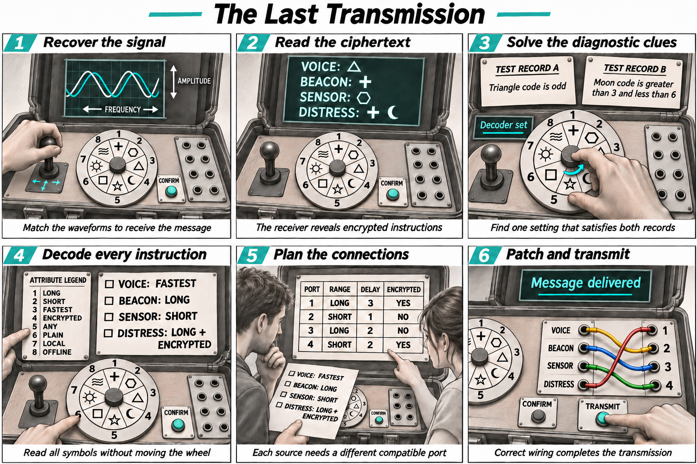

# The Last Transmission Storyboard

Revision 3, November 16 2026. This iteration replaces the explicit calibration card with two incomplete diagnostic clues. Players deduce one wheel setting and use it to decode the complete encrypted dispatch. It covers all three puzzles. This is an AI generated concept illustration, not independent initial sketch evidence or a fabrication drawing. Hardware proportions are illustrative.

## Player actions

1. **Recover the signal.** Use the joystick to match frequency and amplitude. Recover the encrypted dispatch, not the decoder key.
2. **Read the ciphertext.** Voice = Triangle, Beacon = Cross, Sensor = Hexagon, and Distress = Cross plus Moon. Keep all lines available for replay.
3. **Solve the diagnostic clues.** Find two separate test records: Triangle produced an odd-numbered code; Moon produced a code greater than 3 and less than 6. Rotate the disk to find a setting satisfying both, then press Confirm. The encoder records the selected setting. Decoder set acknowledges selection without revealing correctness.
4. **Decode every instruction.** Leave the disk at that setting. Read every symbol against the fixed numbered ring and printed attribute legend to recover the four source requirements.
5. **Plan the connections.** Compare the recovered requirements to the transmitter port table. Each source needs a different compatible port. Reserve the encrypted long range port for Distress and the fastest port for Voice.
6. **Patch and transmit.** Connect Voice to 2, Beacon to 3, Sensor to 4, and Distress to 1. Press Transmit to check the recorded decoder setting and cable assignment and reveal the final message.

## Working substitution

At home, the disk symbols are Triangle, Moon, Star, Square, Sun, Wave, Cross, Hexagon clockwise against fixed numbers 1 through 8. The diagnostic records determine the setting:

| Candidate allowed by the Moon record | Triangle position | Satisfies the odd-code record |
| --- | --- | --- |
| Moon at 4 | Triangle at 3 | Yes |
| Moon at 5 | Triangle at 4 | No |

The unique solution is Triangle at 3 and Moon at 4, two sectors clockwise from Home. No player clue explicitly gives this setting. The entire mapping is then fixed.

| Number | Symbol at this setting | Printed attribute legend |
| --- | --- | --- |
| 1 | Cross | Long range |
| 2 | Hexagon | Short range |
| 3 | Triangle | Lowest delay |
| 4 | Moon | Encrypted |
| 5 | Star | Any delay |
| 6 | Square | Plain |
| 7 | Sun | Local only |
| 8 | Wave | Offline |

| Ciphertext | Player decoded requirement |
| --- | --- |
| Voice = Triangle | Lowest delay |
| Beacon = Cross | Long range |
| Sensor = Hexagon | Short range |
| Distress = Cross + Moon | Long range and encrypted |

The completed checklist in panels 4 and 5 represents the players' interpretation and notes. It is not a prefilled solution prop or automatic screen reveal. The illustration shows the calibrated orientation throughout for readability; operators start at Home. Transmit checks the recorded setting, and reset requires returning to Home. The separate Confirm and Transmit buttons pictured can be implemented with the same contextual button.

## What to test

- Can players combine both diagnostic clues to infer a unique setting, then distinguish those clues from the encrypted dispatch?
- Can players read every symbol without accidentally moving the disk?
- Does port allocation require useful reasoning after decoding?

The earlier tracing card and explicit calibration card images are retained as process history and superseded by this revision. The drawing shows the diagnostic records together for readability; they can be placed separately in the case.

## Asset provenance

Generated and corrected with the built in image generation tool. See [the diagnostic clue edit prompt](storyboard-image-prompt-v3.md). The preceding version and its generation prompts are retained as process history.
