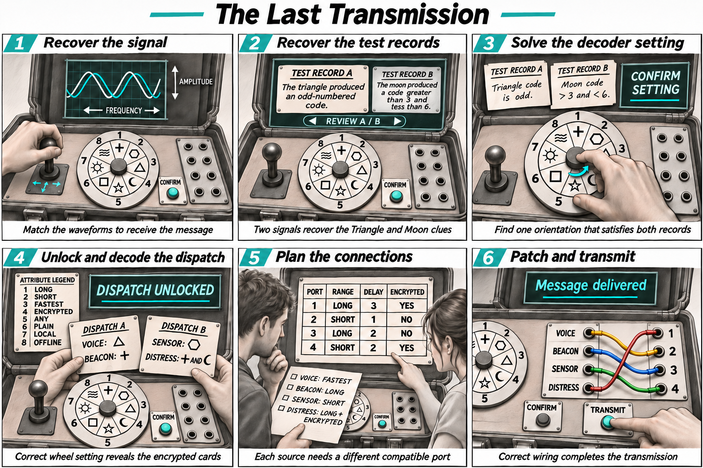

# The Last Transmission Storyboard

Revision 4, November 18 2026. The receiver now reveals the two diagnostic records. Players deduce and confirm the wheel setting to unlock the encrypted dispatch cards, then decode them for the patch puzzle. It covers all three puzzles. This is an AI generated concept illustration, not independent initial sketch evidence or a fabrication drawing. Hardware proportions are illustrative.

## Player actions

1. **Recover the signal.** Use the joystick to match frequency and amplitude. Each successful lock reveals one diagnostic record.
2. **Recover the test records.** Signal 1 gives Triangle produced an odd-numbered code. Signal 2 gives Moon produced a code greater than 3 and less than 6. Keep both available for review; no dispatch is revealed yet.
3. **Solve the decoder setting.** Combine the two records and turn the wheel to satisfy both. Press Confirm. An incorrect setting permits revision; the correct setting unlocks the encrypted dispatch cards.
4. **Unlock and decode the dispatch.** Collect Dispatch A and B only after correct wheel confirmation. They contain Voice = Triangle, Beacon = Cross, Sensor = Hexagon, and Distress = Cross plus Moon. Leave the disk in place and read all symbols using the fixed number ring and attribute legend.
5. **Plan the connections.** Compare the decoded requirements to the port table. Each source needs a different compatible port. Reserve the encrypted long range port for Distress and the fastest port for Voice.
6. **Patch and transmit.** Connect Voice to 2, Beacon to 3, Sensor to 4, and Distress to 1. Press Transmit to check the connections and reveal the final message.

## Working substitution

At home, the disk symbols are Triangle, Moon, Star, Square, Sun, Wave, Cross, Hexagon clockwise against fixed numbers 1 through 8. The diagnostic records determine the setting:

| Candidate allowed by the Moon record | Triangle position | Satisfies the odd-code record |
| --- | --- | --- |
| Moon at 4 | Triangle at 3 | Yes |
| Moon at 5 | Triangle at 4 | No |

The unique solution is Triangle at 3 and Moon at 4, two sectors clockwise from Home. No player clue explicitly gives this setting. The entire mapping is then fixed.

| Number | Symbol at this setting | Printed attribute legend |
| --- | --- | --- |
| 1 | Cross | Long range |
| 2 | Hexagon | Short range |
| 3 | Triangle | Lowest delay |
| 4 | Moon | Encrypted |
| 5 | Star | Any delay |
| 6 | Square | Plain |
| 7 | Sun | Local only |
| 8 | Wave | Offline |

| Ciphertext | Player decoded requirement |
| --- | --- |
| Voice = Triangle | Lowest delay |
| Beacon = Cross | Long range |
| Sensor = Hexagon | Short range |
| Distress = Cross + Moon | Long range and encrypted |

The completed checklist in panel 5 represents player interpretation and notes, not a prefilled clue. Panel 2 summarizes both diagnostic records side by side; the actual receiver shows one record at a time with review controls. The illustration shows the solved wheel orientation throughout for readability; operators start at Home. The confirmation and patch steps are planned full game behavior. The working receiver currently implements waveform matching and diagnostic review, not encoder sensing or dispatch unlocking.

## What to test

- Does the release order make sense: receiver reveals diagnostic records, correct wheel confirmation unlocks the dispatch, and decoded dispatch enables patching?
- Can players read every symbol without accidentally moving the disk?
- Does port allocation require useful reasoning after decoding?

The earlier tracing card and explicit calibration card images are retained as process history and superseded by this revision. The drawing summarizes the recovered records; they are now receiver rewards rather than initial physical clues. Paper testing can reveal their printed versions after simulated signal locks.

## Asset provenance

Generated and corrected with the built in image generation tool. See [the release order edit prompt](storyboard-image-prompt-v4.md). The preceding version and its generation prompts are retained as process history.
