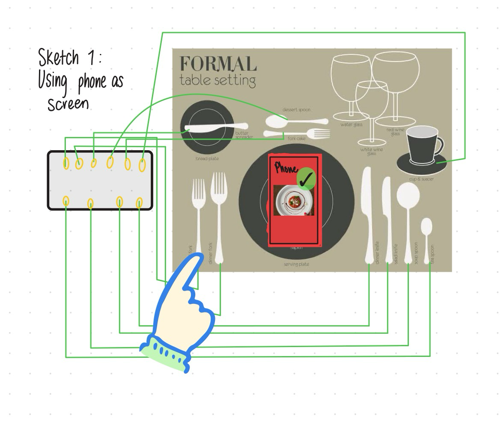
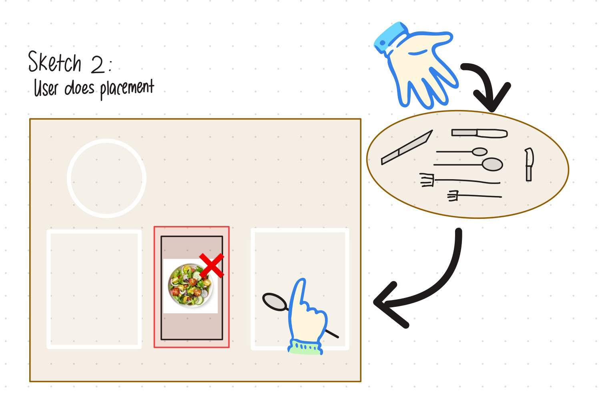
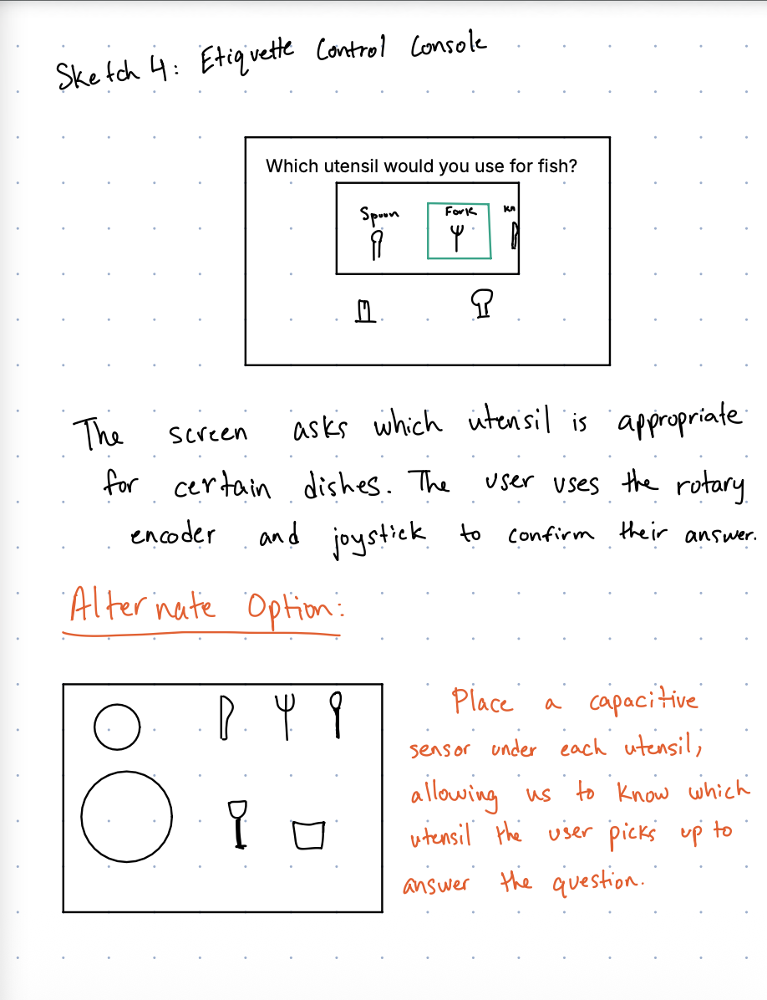
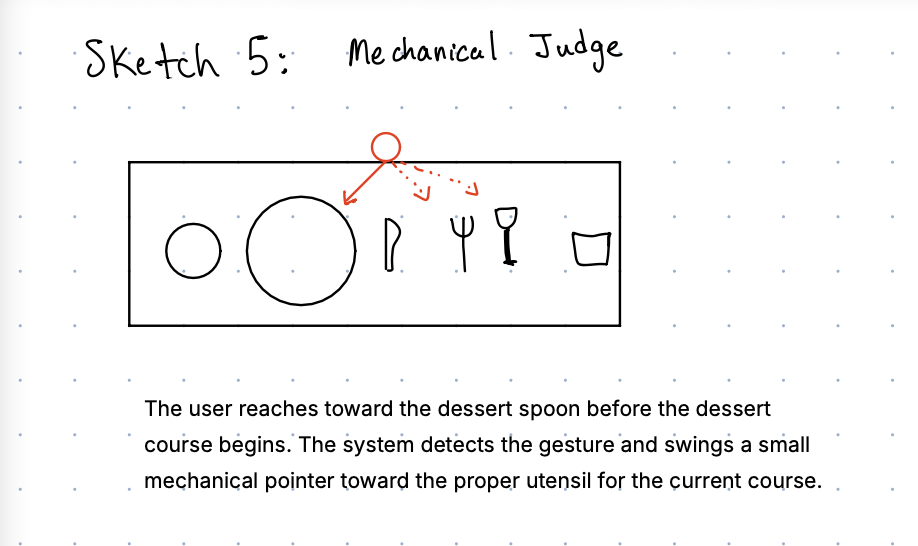
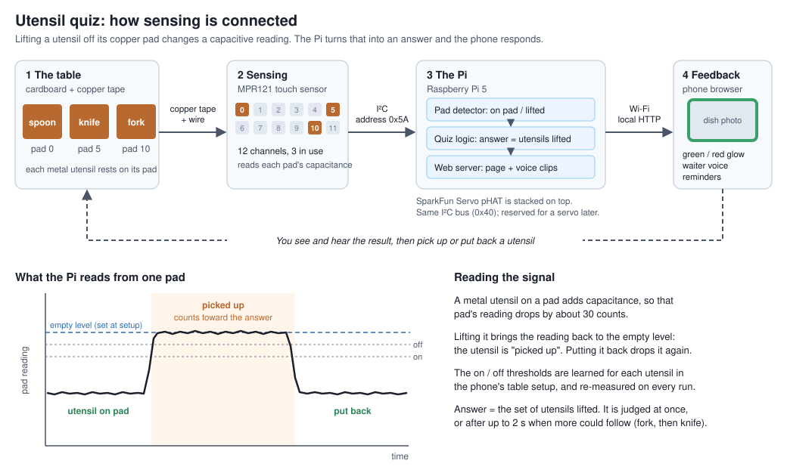

# Lab 4: Fine Dining Etiquette

## Team

- Jonathan Tumalle (jrt285)
- Ani Hadagali (ah2495)

## Part 1: Physical Interaction Design

### Design sketches

### Prototyping questions

Some questions came up include:

- If we went with the automatic dispenser idea, how would it dispense the utensils? How would we know it's strong enough to lift them up in a safe way?
	- For this we would need to simulate the dispensing. We could add weights to a platform the motor can push up and experiment to see what the limit is and compare it to the average weight of the most heavy utensil.
- For sketch 5, how would we know the motor can move to an angle that actually points to the correct object? Would we need a more precise motor than what we have available?
	- For this we could set up two utensils next to each other (a fork and a spoon) as they would in a regular table setting and see if we can utelize computer vision to determine there are 2 utensils.
- For using the sensors, how would we hide the connection to the sensors so that it isn't distracting from how it should be used?
	- We could prototype the system with just one fake paper utensil to see if we can hide the wiring.
- When we fix the number of utensils we allow the user to use, how do we know that we cover all the cases seen in the "fine dining" world?
	- This is not something physical prototyping can address since this is more of a hypothetical.
- How will the system determine whether a utensil has been placed in the correct position?
	- We could place capacitive sensors beneath designated table positions and test whether they can detect a utensil being placed or removed. We could try different sensor positions and materials between the sensor and utensil to determine how reliably the system detects placement.
- How will the system distinguish between different utensils placed in the same location?
	- We could test whether capacitive sensing can distinguish a fork from a spoon or whether we need separate designated placement zones. We could also experiment with identifying utensils through their shape or by attaching small markers, if appropriate.		
- How do we prevent the sensors from detecting a utensil that is near a position but not actually placed there?
	- We could move utensils around the edges of each sensing zone and test when the sensor activates. This would help us determine the appropriate size and spacing of each zone.
- How can we avoid forcing the user to constantly look between the phone and the table?
	- We could prototype alternative feedback methods, such as highlighting the next position on the phone while using a physical indicator or OLED at the table. We could then compare how easily users follow the instructions.
- How do we know the system has correctly detected the user's action?
	- We could test a series of known actions, such as picking up a fork, moving a spoon, or placing a knife down. We could compare the system's detected actions with what actually happened and record how often it makes mistakes.
- How long can the user wait between performing an action and receiving feedback?
	- We could measure the time between a sensor detecting an action and the display or servo responding. We could test different delays and observe whether the interaction feels immediate enough.

### Selected design

The user sits down at a simulated dining table. A screen displays a dish, such as soup, and asks the user to select the correct utensil. The user picks up a paper fork, knife, or spoon from the table setting. The system tells them whether their choice is correct and explains the appropriate etiquette.

I'd choose this design because it combines physical interaction, sensing, and feedback in a simple experience. It also lets you test the core idea before investing time in building the dispenser or integrating real sensors.

### Rough prototype

## Part 2: Build & Integrate

### Working prototype: At the Table

The [phone viewer prototype](fine_dining/README.md) reads our capacitive cutlery sensor and gives live dining feedback. See its guide for starting/stopping the app, mapping utensils to channels, and editing scenarios.

From the repository root, run `"Lab 4/fine_dining/start.sh"` and open the printed URL on a phone on the same network. Stop with Ctrl+C.

### Iterations

[First prototype with fork video](https://drive.google.com/file/d/1KweES5yMQHb_wpn-slzBBrMNjegRI4kd/view?usp=share_link)
[Using phone for visuals](https://drive.google.com/file/d/1zc7f8b6v1P_vZ7R6gkTLNZFUfj7gj0DY/view?usp=share_link)
[Adding pictures and sound](https://drive.google.com/file/d/1Vb70O3qMolQDKml19VvHgUlTDk6Bypk4/view?usp=share_link)

### Final prototype

The updated [prototype code and setup guide](fine_dining/README.md) includes calibration for copper-tape pads, utensil lift detection, and answers that combine multiple utensils.

[Working prototype video](https://drive.google.com/file/d/1w5CJkUc3LJbKacPssRfXj9YGkljTIEM5/view?usp=drive_link)

### Sensing and interaction diagram

Ani created this diagram with AI using his system design and explanation of the connections.

### Ani’s reflection

I learned a lot about physical prototyping through this lab. Even creating the paper prototype was difficult and needed time and effort to get it right. I am used to software, and how easy it is to manipulate and change as I need, but physical resources are much harder. One thing I needed to seek out was a way to demonstrate wire, which caused me to ask my mom if she had any yarn laying around. It forced me to be creative, which was a different skill I had to learn. It was really fun to see a physical end product which I could easily show friends and family, but I would say it was really challenging to work with the copper tape and making sure to get the connection just right.

### Sensing and physical design observations

- Sensor behavior
  - The MPR121 senses capacitance, so it reacts to a conductive object touching a copper pad, not to someone's intention. A utensil resting on its pad lowers that pad's reading by about 30 counts. The dining answer is the moment a utensil leaves the pad, and the table's idle state is all three utensils resting in place. The sensor also can't tell which utensil is which, only which pad it sees, and a plastic utensil is invisible to it. It needed a calibration step in the experience: measure each empty pad, then learn each utensil.
- Physical arrangement
  - Pad contact matters. Pad size and how flatly a utensil rests decide how strong the signal is. My thresholds at first missed a utensil put back too lightly, and the quiz got stuck thinking it was still up.
  - This prompted me to raise the copper pad up so it would act as a spring for the utensil to sit on, thus getting ample signal
  - The display moved off the table. The MiniPiTFT didn't fit with the Servo pHAT, so feedback goes to a phone instead. Your hands and attention stay on the utensils while you glance at the phone for the result
- Thresholds, timing, and feedback
  - Lifting and putting back: on and off thresholds at 40% and 20% of the learned drop. This was the most challenging piece. My utensils were not making good contact with the pads, so I tweaked it by adding an easier contact point.
  - Multi-utensil answers: the Pi waits up to 2 seconds only while your hand could still grow into a correct answer. Fork then knife on the steak works, but the fork alone counts as wrong after 2 seconds. A spoon for soup is judged instantly.
  - Feedback: a green or red glow, the waiter's voice, and an "In hand: Fork" line so you can see the Pi noticed you. A reminder to put a utensil back appears 2 to 5 seconds late, depending on the situation, so it nudges without nagging
  - Playfulness: wrong answers stay on screen until you retry, so you can keep guessing without penalty.
- Sensor placement iterations
  - Initially I built the copper tape to be flush with the cardboard box so it would look seamless. This posed a problem as my utensils didn't sit well on the surface to make good contact. I had to mess with the copper wires a lot to get them to work. At one point, the capacitative sensor pad itself didn't work, so I had to switch to a different pad.

## Part 3: Final Documentation

### Looks like

- A cardboard place setting. Three copper-tape pads sit on the card, with a real spoon, knife and fork resting one per pad. The Pi, the MPR121 breakout and the Servo pHAT are tucked out of sight, and a phone stands beside the setting as the "menu."

### Works like

- A utensil resting on a pad changes that pad's reading, and the MPR121 reports it over I²C to the Pi.
- The Pi runs a short table setup to learn each pad. Then it works out which utensils are lifted and judges the answer, including multi-utensil ones like fork and knife for the steak.
- It serves a four-course dinner (lobster bisque, burrata, filet mignon, torte) to the phone over local Wi-Fi, with photos, the waiter's voice, and green or red feedback.
- Limits: it senses pads, not utensils, so a plastic utensil is invisible

### Acts like

- Open the page on your phone and set the table: clear it, tap measure, then place each utensil when prompted.
- Tap Start dinner and listen to the waiter introduce the course.
- Pick up the utensil or utensils you'd use. The phone shows "In hand: …" while it waits.
- See the result, green for correct or red for wrong with a hint, and hear the waiter respond.
- Put the utensils back to continue. If you forget, a banner reminds you after a couple of seconds.
- After the last course, see how many you got right on the first try.
