# Observant Systems: Overnight Sensation

**Team:**

**Members:** Jonathan Tumalle (jrt285, @jontumalle)

**Project name:** Automated Vacation Blogger

<details>
	<summary><strong>Instructions for Students (Click to Expand)</strong></summary>
  
	**Submission Cleanup Reminder:**
	- This README.md contains extra instructional text for guidance.
	- Before submitting, remove all instructional text and example prompts from this file.
	- You may delete these sections or use the toggle/hide feature in VS Code to collapse them for a cleaner look.
	- Your final submission should be neat, focused on your own work, and easy to read for grading.
  
	This helps ensure your README.md is clear, professional, and uniquely yours!
</details>


For lab this week, we focus on creating interactive systems that can detect and respond to events or stimuli in the environment of the Pi, like the Boat Detector we mentioned in lecture. 
Your **observant device** could, for example, count items, find objects, recognize an event or continuously monitor a room.

This lab will help you think through the design of observant systems, particularly corner cases that the algorithms need to be aware of.

**New this year: the AI runs on the Pi.** Your Pi 5 can run an object detector ([YOLO](https://docs.ultralytics.com/)) and a small language model ([Qwen](https://ollama.com/library/qwen3.5) through [Ollama](https://ollama.com)) completely offline. In Part 1 you get both running and connect them: YOLO *sees*, Qwen *reasons* about what was seen. These models are slow, but they have all night. In Part 2 you use them to design a **night-time interaction**: what you tell the device before bed, what it does while you sleep, and what it shows you when you wake up.

**Please indicate anyone that helped with this Lab here.**
Be generous in acknowledging their contributions! And also recognizing any other influences (e.g. from YouTube, Github, Twitter) that informed your design. 

## Overview

**Part 1: the tools**

A) [Set up your Pi for on-device AI](#part-a)

B) [See: recognize people in real time with YOLO](#part-b)

C) [See more: hands and pose with MediaPipe](#part-c)

D) [Reason: run Qwen on the Pi with Ollama](#part-d)

E) [Connect: from YOLO readings to Qwen reasoning](#part-e)

**Part 2: Overnight Sensation**

F) [Read Part 2 and storyboard your night-time interaction](#part-f)

G) [Design the interaction before bed](#part-g)

H) [Incorporate the observant system during sleep](#part-h)

I) [Design the interaction when awake](#part-i)

The tools from earlier versions of this lab (MobileNet, Teachable Machine, Moondream, audio analysis, classic OpenCV) live in the [legacy folder](legacy/README.md). They are optional, but any of them can be the sensor in your Part 2 system.


## Prep for Part 1

Please check the instructions in [prep.md](prep.md) and complete them before lab. The installs in Part A take a while, so prep.md also tells you how to get a head start.

## The Report

This readme.md page in your own repository should be edited to include the work you have done. You can delete everything but the headers and the sections between the \*\*\***stars**\*\*\*. Write the answers to the questions under the starred sentences. Include any material that explains what you did in this lab hub folder, and link it in the readme.

---

# Part 1

## Part A. 
### Set up your Pi for on-device AI

Create a virtual environment and install the requirements. They include `ultralytics` (YOLO), which pulls in torch, so this takes a while:

```
pi@raspberrypi:~$ cd Interactive-Lab-Hub/Lab\ 5
pi@raspberrypi:~/Interactive-Lab-Hub/Lab 5 $ python3 -m venv .venv
pi@raspberrypi:~/Interactive-Lab-Hub/Lab 5 $ source .venv/bin/activate
(.venv) pi@raspberrypi:~/Interactive-Lab-Hub/Lab 5 $ pip install -r requirements.txt
```

As in Lab 3, [`uv`](https://docs.astral.sh/uv/) is a much faster drop-in for `pip`: `pip install uv && uv pip install -r requirements.txt`.

### YOLO: download the nano model and export it for the Pi

We use the nano model of [YOLO26](https://docs.ultralytics.com/models/yolo26/), exported once to NCNN, the format that runs fastest on the Pi. This downloads the weights:

```
(.venv) pi@raspberrypi:~/Interactive-Lab-Hub/Lab 5 $ python -c "from ultralytics import YOLO; YOLO('yolo26n.pt').export(format='ncnn')"
(.venv) pi@raspberrypi:~/Interactive-Lab-Hub/Lab 5 $ yolo export model=yolo26n.pt format=ncnn
```
If every ultralytics message is followed by a `--- Logging error ---` traceback ending in `UnicodeEncodeError: 'latin-1' codec can't encode character`, fix your shell's locale once::

```
echo 'export LANG=C.UTF-8' >> ~/.bashrc
echo 'export LC_ALL=C.UTF-8' >> ~/.bashrc
echo 'export PYTHONIOENCODING=utf-8' >> ~/.bashrc
source ~/.bashrc
```

The second command converts the .pt model to a .ncnn model.

Test it on an image from the internet. `project="$PWD"` keeps the output in `predict` in the current lab folder; without it, ultralytics writes to a `runs/` folder at the top of your git repo, where you will not think to look.

```
(.venv) pi@raspberrypi:~/Interactive-Lab-Hub/Lab 5 $ yolo predict model=yolo26n_ncnn_model source=https://ultralytics.com/images/bus.jpg project="$PWD"
```

The result is in `predict/bus.jpg`: boxes around the people and the bus.

Now a photo of your own. Plug in the webcam and take one with `snap.py` (`--delay 3` gives you three seconds to get into the frame), or choose any picture you downloaded from the internet and put under this folder. Put your selected picture after the `source=` Then run the same command on it:

```
(.venv) pi@raspberrypi:~/Interactive-Lab-Hub/Lab 5 $ python snap.py --delay 3
(.venv) pi@raspberrypi:~/Interactive-Lab-Hub/Lab 5 $ yolo predict model=yolo26n_ncnn_model source=snap.jpg project=runs
```

Every run gets its own numbered folder, so this one is in `runs/predict2/snap.jpg`; the command prints where it saved. Keep `snap.jpg`, you will show it to Qwen in Part D.

### Ollama: install it and pull Qwen

[Ollama](https://ollama.com) runs language models locally. Nothing leaves the Pi: no API key, no internet after the download.

```
pi@raspberrypi:~ $ curl -fsSL https://ollama.com/install.sh | sh
pi@raspberrypi:~ $ ollama pull qwen3.5:0.8b
pi@raspberrypi:~ $ ollama pull qwen3:0.6b
pi@raspberrypi:~ $ ollama list
```

| model | download | what it does |
|---|---|---|
| `qwen3.5:0.8b` | ~1.3 GB | text **and images**; the one we use in this lab |
| `qwen3:0.6b` | ~0.5 GB | text only, smaller and faster (~16 tokens/s on a Pi 5) |

\*\*\***Include a screenshot of `ollama list` showing your models.**\*\*\*

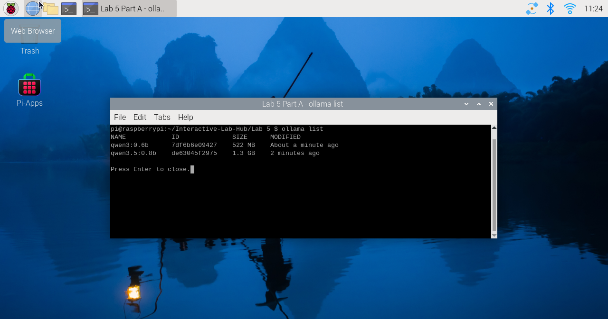


## Part B. 
### See: recognize people in real time with YOLO

YOLO is an *object detector*: it finds every person, cup, cat and so on (the 80 [COCO](https://cocodataset.org/) classes), draws a box around each, and gives a confidence. For an observant system that is exactly what you want: *how many*, *where*, *how sure*.

Connect your webcam, connect to your Pi through **VNC** (the script opens a window), and run the person detector. Read `yolo_person.py` first; the loop at the bottom is the whole idea.

```
(.venv) pi@raspberrypi:~/Interactive-Lab-Hub/Lab 5 $ python yolo_person.py
```

While it runs, walk in and out of the frame, sit down, turn your back, hold up a photo of a person on your phone. Watch the confidence number on the box change with each.

Then press q to quit and run it again with a flag. Each one changes a single thing:

```
(.venv) pi@raspberrypi:~/Interactive-Lab-Hub/Lab 5 $ python yolo_person.py --conf 0.2     # lower the bar: see what the model is unsure about
(.venv) pi@raspberrypi:~/Interactive-Lab-Hub/Lab 5 $ python yolo_person.py --conf 0.7     # raise the bar: see what you lose
(.venv) pi@raspberrypi:~/Interactive-Lab-Hub/Lab 5 $ python yolo_person.py --all          # all 80 classes, not only people: what else is on your desk, and what does it get wrong?
(.venv) pi@raspberrypi:~/Interactive-Lab-Hub/Lab 5 $ python yolo_person.py --headless     # no window, only the printed readings: how it runs over ssh, and at night
```

\*\*\***Include a short video or screenshots of your experiments with the person detection. Write down three situations where it did not see you, or saw a person who was not there, and what you think the cause was.**\*\*\*


**Experiments recorded:** The same live webcam frame was evaluated using YOLO26n NCNN at `imgsz=320`, people only. One person was detected at **0.7803 confidence** at each threshold below. Raising the threshold to 0.7 did not remove this detection.

| Confidence threshold | People detected | Webcam capture |
|---|---|---|
| 0.2 | 1 | [Screenshot](screenshots/part-b-baseline-0.2.jpg) |
| 0.4 (default) | 1 | [Screenshot](screenshots/part-b-baseline-0.4.jpg) |
| 0.7 | 1 | [Screenshot](screenshots/part-b-baseline-0.7.jpg) |

**Three situations where person detection can fail:**

1. **Moving quickly across the camera:** The person scored **0.6777**, below 0.7. The face and body are visibly blurred. This motion blur removed some of the edges and details the detector uses, lowering its confidence.

   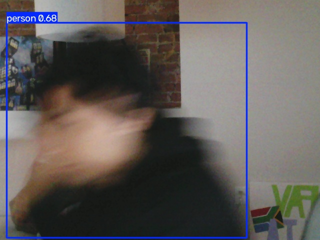

2. **Leaning sideways into the left edge:** The person scored **0.5024**, below 0.7. Much of the body is outside the image. I think that the unusual pose and incomplete body outline made recognition less certain.

   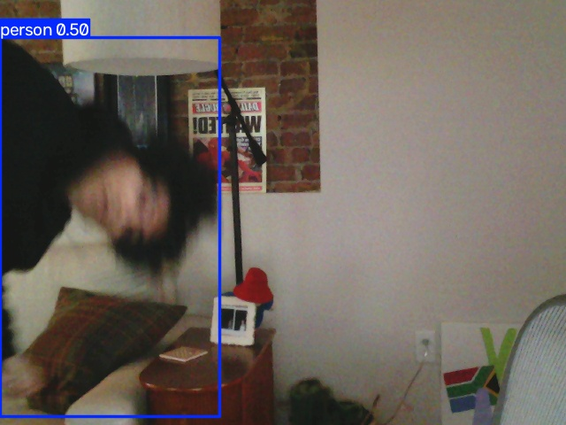

3. **Holding up a toy figure while hiding my face:** YOLO drew a separate person box around the Spider-Man figure with **0.6548 confidence**. I think the figure's human-shaped body checked off most of the boxes the detector associates with people.

   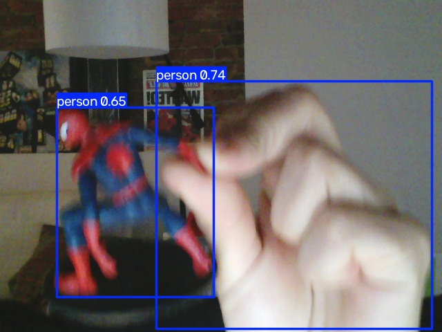

The first two situations were successful detections at the default threshold, but would be missed at 0.7. The toy experiment produced an actual false person detection: YOLO recognized a human-like shape without distinguishing a toy from a real person. Raising the threshold to 0.7 would remove this particular toy detection, but would also lose the real-person detections in the first two examples.


## Part C. 
### See more: hands and pose with MediaPipe

YOLO tells you that a person is there. Google's [MediaPipe](https://mediapipe.dev/) tells you what their hands and body are doing: face, hand and body pose detection, fast on the Pi.


The demo plays a looping audio file, so make the helper script executable first:

```
(.venv) pi@raspberrypi:~/Interactive-Lab-Hub/Lab 5 $ chmod +x loop_audio.sh
```

Connect your webcam, connect to your Pi through **VNC**, and run the hand pose script:
(***it will not work if you use ssh from your laptop***)

```
(.venv) pi@raspberrypi:~/Interactive-Lab-Hub/Lab 5 $ python hand_pose.py
```

Try the two main features of this script: 1) pinching for percentage control (the thumb-to-index distance sets the volume), and 2) "[Quiet Coyote](https://www.youtube.com/watch?v=qsKlNVpY7zg)" for instant percentage setting (the gesture mutes it). Notice how this example uses hardcoded positions and relates those positions with a desired set of events, in `hand_pose.py`: a hand is 21 landmark coordinates, and an *event* is a rule you write over them. That is the same job as `interpret()` in Part E.

Consider how you might use this position based approach to create an interaction, and write how you might use it on either face, hand or body pose tracking.

\*\*\***Include a screenshot or short video of the hand pose demo, and write how you might use face, hand or body pose tracking in your observant system.**\*\*\*

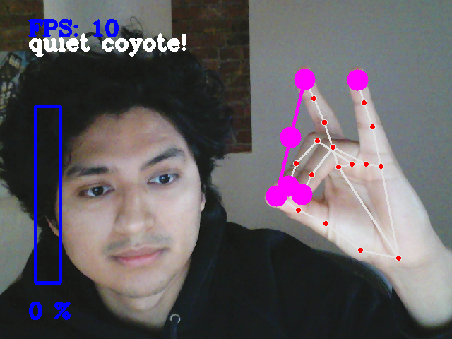

Face and hand gestures can be an interesting way of more naturally send signals of feeling. Some people, like myself, tend to use hand gestures so it may be interesting to compose Speech-to-Text with hand gesture recognition to really convey meaning.


## Part D. 
### Reason: run Qwen on the Pi with Ollama

Talk to the model in the terminal first. Qwen3 models "think" before they answer, which is slow on a Pi, so turn it off. Then ask about something you can check:

```
pi@raspberrypi:~ $ ollama run qwen3.5:0.8b
>>> /set nothink
>>> Tell me a bit about the history of Roosevelt Island. Three sentences.
>>> /bye
```

Roosevelt Island is a good first question because you know the ground truth: it was Blackwell's Island, then Welfare Island, got its current name in 1973, and Cornell Tech opened on it in 2017. Count how many of the model's facts are true.

From Python, qwen requests can be triggered by the `ask_qwen.py` script. It turns thinking off, tells the model to answer in at most three sentences, and cuts it off after 120 tokens (`--max-tokens` changes that), because a small model left alone writes an essay. Read the script, then run:

```
(.venv) pi@raspberrypi:~/Interactive-Lab-Hub/Lab 5 $ python ask_qwen.py "Tell me a bit about the history of Roosevelt Island."
(.venv) pi@raspberrypi:~/Interactive-Lab-Hub/Lab 5 $ python ask_qwen.py --model qwen3:0.6b "Tell me a bit about the history of Roosevelt Island."
(.venv) pi@raspberrypi:~/Interactive-Lab-Hub/Lab 5 $ python ask_qwen.py --image snap.jpg "What is in this photo?"
```

Things in the [Ollama API](https://github.com/ollama/ollama/blob/main/docs/api.md) worth knowing:

* `think: false` skips the reasoning trace. Always, on a Pi. `ask_qwen.py` sends it on every request; `--think` turns the trace back on for one question, so you can see what you are skipping and how long it takes.
* `format` makes the model answer as JSON with the fields you name (`--json`). Handy when a display or a servo has to read the answer.
* `images` sends a photo along with the prompt (`--image snap.jpg`, the photo from Part A). `qwen3.5:0.8b` can look at pictures.

A 0.8B model is slow and sometimes wrong. It will invent events that are not in the data and agree with a wrong premise. Give it the data, keep its job narrow, and decide what the device does when the model is unsure.

\*\*\***Ask Qwen three questions to answer. Paste the questions, the answers and how long each took. Try one of them with `qwen3:0.6b` and compare.**\*\*\*

Question 1: The spurs part was right but the second part is wrong (it's the knicks)

```txt
$ uv run ask_qwen.py --image snap.jpg "What teams are playing in this photo?"
The image shows an NBA game between the San Antonio Spurs (wearing black jerseys with white numbers) and the Houston Rockets (wearing white jerseys with orange numbers).

[qwen3.5:0.8b, 62.7 s]
```

Question 2:

```txt
$ uv run ask_qwen.py "Who is batman's greatest enemy?"
Batman's greatest enemy is the Joker, who uses chaos and madness to destroy Gotham City.

[qwen3.5:0.8b, 3.3 s]
```

Question 3: This one really overestimates the average human and gets the marathon distance wrong

```txt
$ uv run ask_qwen.py "How long does it take to run a marathon?"
It takes about 2 hours for an average person to complete a standard 42-mile race.

[qwen3.5:0.8b, 4.4 s]
```

Question 3 w/ `qwen3:0.6b`: I guess it can be right if you took a casual marathon walk.

```txt
$ uv run ask_qwen.py --model qwen3:0.6b "How long does it take to run a marathon?"
It takes approximately 16 hours to run a marathon, depending on your pace and training level.

[qwen3:0.6b, 1.2 s]
```


## Part E. 
### Connect: from YOLO readings to Qwen reasoning

An observant system is a pipeline: a **detector** turns pixels into boxes, an **interpreter** turns boxes into readings in words ("one person, left, close"), the readings pile up in a **log**, and a **reasoner** answers a question about the log. The language model never sees pixels, only the words you chose in the interpreter. That makes the interpreter the most important design decision in the system.

`yolo_to_qwen.py` is the pipeline in one file, one function per stage. Read it before you run it:

* `interpret(r)` is the interpreter. It takes one YOLO result and returns one reading. A person is *left*, *center* or *right* by which third of the frame the middle of their box is in, and *close* if the box is taller than 60% of the frame, *far* otherwise. The reading is a string like `1 person(s) at center/close`, or `nobody`. Fifteen lines, and they decide everything the model can know.
* `watch(seconds)` is the detector and the log. Twice a second it reads a frame, runs YOLO on it and calls `interpret()`. A time-stamped reading goes into the log **only when it differs from the previous one**, so a minute of sitting still is one line, not 120.
* `ask(log, question)` is the reasoner. It pastes the log and your question into one prompt, tells Qwen to answer in at most three sentences using only what is in the log, and sends it to Ollama with thinking off.

Run it through VNC and a window opens with YOLO's boxes, the current reading and the seconds left. Press q to stop watching early. Over plain ssh add `--headless` and you get the same thing minus the window.

```
(.venv) pi@raspberrypi:~/Interactive-Lab-Hub/Lab 5 $ python yolo_to_qwen.py
```

It watches for a minute, saves the log to `watch_log.txt` and asks Qwen the default question. The terminal looks something like this:

```
14:02:11 nobody
14:02:19 1 person(s) at right/far
14:02:24 1 person(s) at center/close
14:02:51 nobody

4 lines saved to watch_log.txt
asking Qwen...

Qwen (18.4 s):
One person came in from the right, moved close to the camera, and left after about half a minute. ...
```

---

# Lab 5 Part 2: Overnight Sensation

**Automated Vacation Blogger** uses the **process-all-night** approach: submit vacation photos before bed and return to a connected, narrated itinerary.

[Source and setup](vacation_story/README.md) · [Interaction design](vacation_story/docs/day-journey.md) · [Verification](vacation_story/docs/verification.md)

## Part F.
### Interaction concept

Originally, the idea was supposed to be to output an AI generated video:

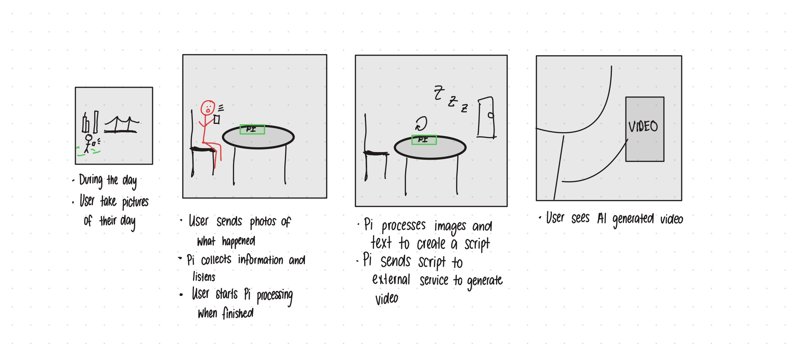

Then, I realized all I really want is a story to be generated:

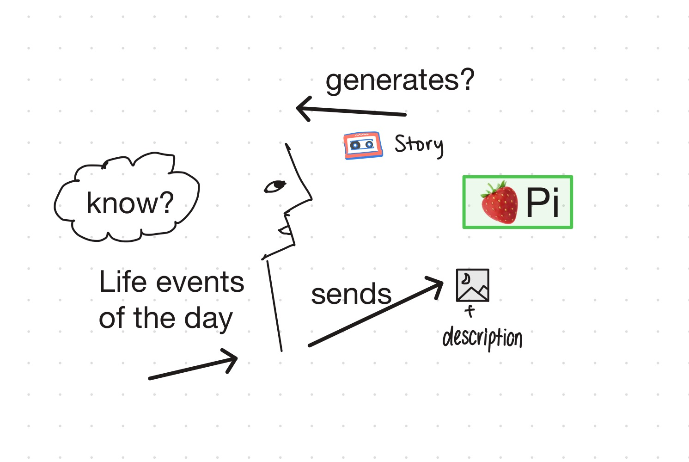

## Prep for Part 2
### Feedback and iterations

Normally people do not just take pictures throughout the day. This is more likely during vacation, so the idea shifted to generating interactive stories from your vacations.
I also got feedback that a picture needs additional context about what happened and how people felt. Adding pointed questions to decribe what the user felt in those moments
enhances the understanding of the moment.

Here are some screenshots and videos from the initial prototype:

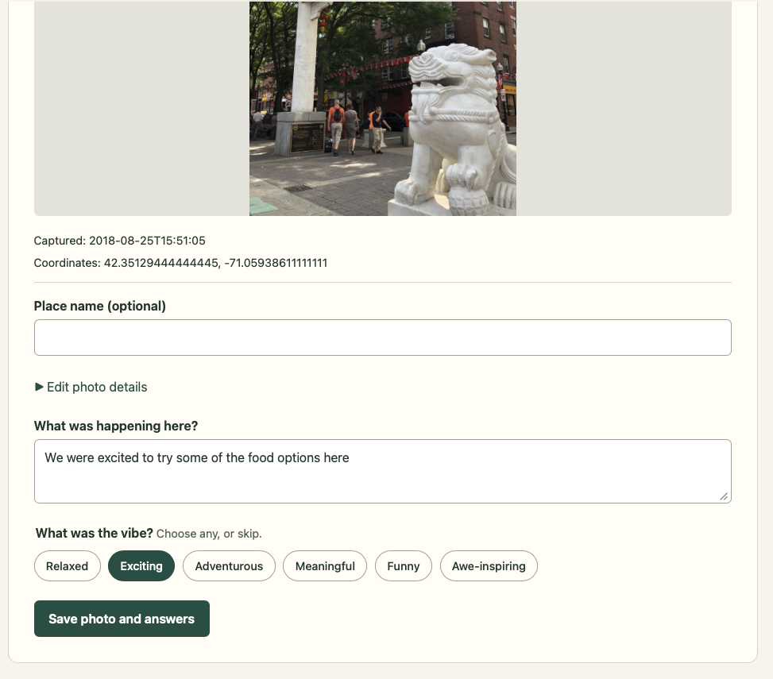
User enters description.

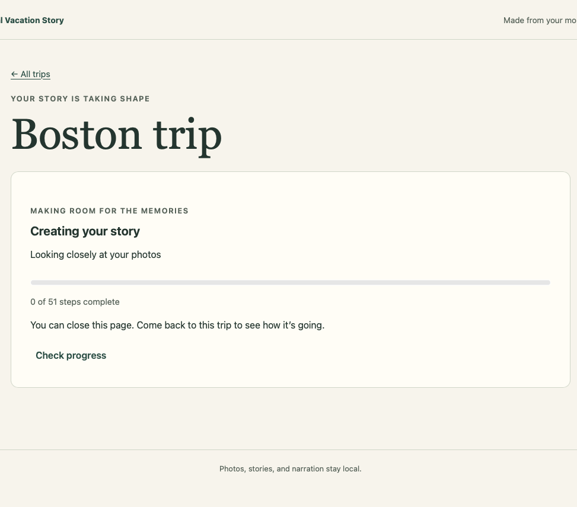
User leaves the pi to process overnight.

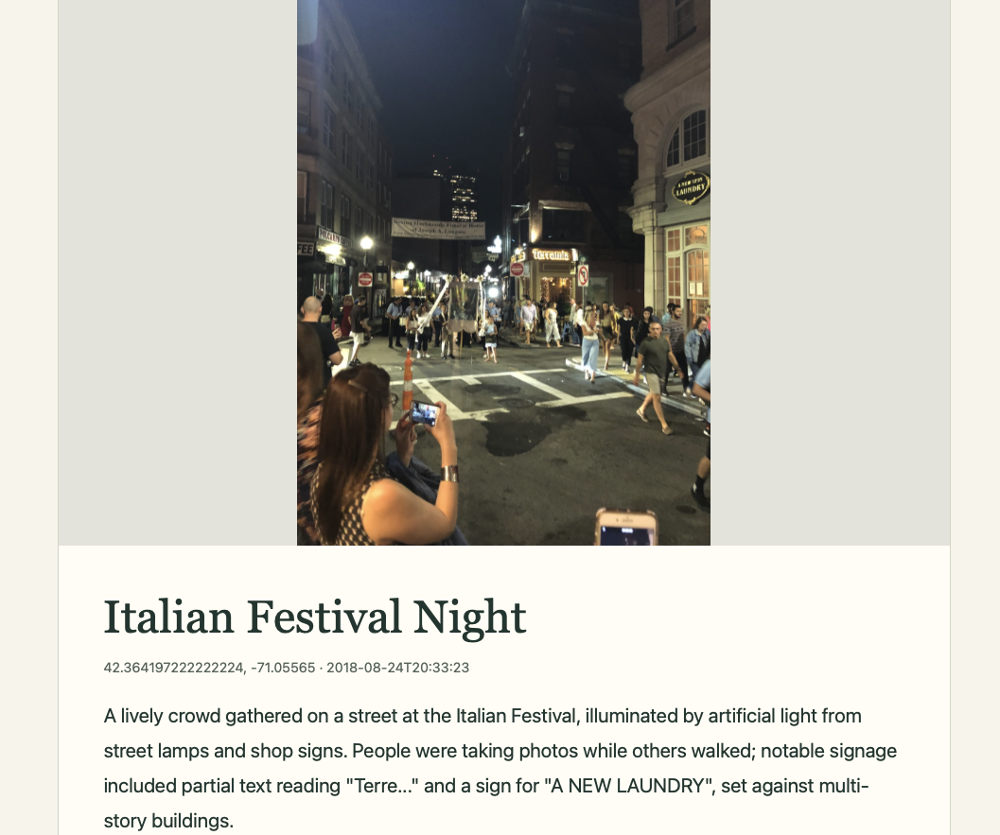
User gets a story per photo. The initial version making a story for every picture was overkill. It was too much content and the content was just pointing out things in the picture
which the user can already do.

Here is other feedback gathered:
-  **Reduce repetitive input:** Replaced individual uploads with bulk selection, while retaining optional per-photo details.
-  **Make memories feel connected:** Isolated captions became an I/we travel journal using shared trip context. After trying the rewrite, I preferred it, so connected storytelling became the only final output.
-  **Offer overview before detail:** Added a route map and one narration per day, with clickable moments for deeper exploration.
-  **Reduce visual clutter:** Nearby thumbnails now group together and separate as the owner zooms in; identical locations have a photo chooser.
-  **Make failure recoverable:** Clearer phone-upload errors, local voice setup checks, saved progress, and audio-only retry improve confidence in leaving work with the Pi.

{Insert new storyboard here}

From the feedback and new storyboard, I made the following iteration:

{Insert video here}

## Part G.
### Design the interaction before

- **Before bed:** Upload photos and optional context; receive save confirmation and processing acknowledgement.
- **While asleep:** The Pi interprets the collection, writes connected stories, and generates narration, saving progress along the way.
- **When awake:** Explore the journey map, listen to each day's story, and select individual photo **moments**.

## Part H.
### Incorporate the observant system

The Part 1 observation -> interpretation -> reasoning pattern now processes selected photos. Local Qwen observations are combined with human notes and corrected metadata. A shared outline connects moments; daily stories receive local Piper narration.

One worker saves completed stages for retry. Photos, inference, and speech stay on the Pi; map tiles require internet. Missing narration leaves readable text. Route arrows connect photo positions, not a recorded walking/driving path.

Screenshot of running system:
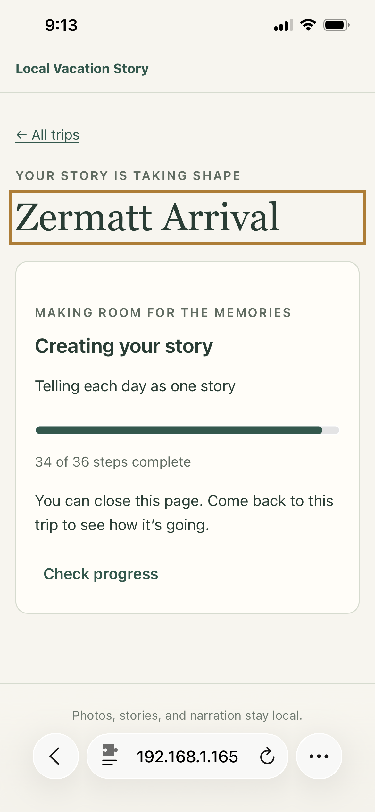

## Part I.
### Design the interaction after

The map shows the whole journey first. **Listen to the whole journey** plays day stories in order. Selecting a photo opens and plays its moment; returning allows deliberate day-level resume. Pause and navigation keep the owner in control.

## Final documentation

**Final demo:** [Watch the Automated Vacation Blogger demo](https://drive.google.com/file/d/1Cy7Wm30sdsGMV8debpgiEohwO9tLlVH3/view?usp=drivesdk) — bulk photo upload, photo questions, a shortened processing sequence, and the narrated journey map with moments.

- **Looks like:** A journey map, grouped thumbnails, day stories, and moment details.
- **Works like:** A local, resumable pipeline turning photos and human context into narrated stories.
- **Acts like:** A before-bed handoff, background work, and an overview-first return.
- **Main learning:** Slow on-device AI needs a clear handoff, acknowledgement, and return. Human context provides meaning that visual recognition alone cannot establish; uncertainty and recovery must remain visible.
- **Validation:** 23 automated checks pass; Chromium is skipped. Full overnight/device verification remains manual.

**Contributions:** Jonathan Tumalle provided project direction, real-photo trials, and interaction feedback. Codex and delegated agents assisted with implementation, debugging, testing, research, and documentation. Relive and FindPenguins informed the map interactions; references are in the [design notes](vacation_story/docs/day-journey.md).
