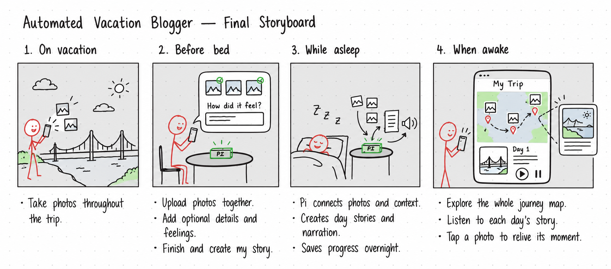

# Observant Systems: Overnight Sensation

**Members:** Jonathan Tumalle (jrt285, @jontumalle)

**Project name:** Automated Vacation Blogger

**Final demo:** [Watch the Automated Vacation Blogger demo](https://drive.google.com/file/d/1Cy7Wm30sdsGMV8debpgiEohwO9tLlVH3/view?usp=drivesdk) — bulk photo upload, photo questions, a shortened processing sequence, and the narrated journey map with moments.

## Overview

**Part 1: On-device AI experiments**

- [Part A: Model setup](#part-a)
- [Part B: Person detection with YOLO](#part-b)
- [Part C: Hand pose with MediaPipe](#part-c)
- [Part D: Qwen questions and comparison](#part-d)
- [Part E: YOLO-to-Qwen pipeline](#part-e)

**Part 2: Automated Vacation Blogger**

- [Part F: Interaction concept](#part-f)
- [Feedback and iterations](#feedback-and-iterations)
- [Part G: Before bed](#part-g)
- [Part H: Overnight processing](#part-h)
- [Part I: Morning experience](#part-i)
- [Final documentation](#final-documentation)

# Part 1

## Part A.
### Model setup


## Part B.
### Person detection with YOLO

**Experiments recorded:** The same live webcam frame was evaluated using YOLO26n NCNN at `imgsz=320`, people only. One person was detected at **0.7803 confidence** at each threshold below. Raising the threshold to 0.7 did not remove this detection.

| Confidence threshold | People detected | Webcam capture |
|---|---|---|
| 0.2 | 1 | [Screenshot](screenshots/part-b-baseline-0.2.jpg) |
| 0.4 (default) | 1 | [Screenshot](screenshots/part-b-baseline-0.4.jpg) |
| 0.7 | 1 | [Screenshot](screenshots/part-b-baseline-0.7.jpg) |

**Three situations where person detection can fail:**

1. **Moving quickly across the camera:** The person scored **0.6777**, below 0.7. The face and body are visibly blurred. This motion blur removed some of the edges and details the detector uses, lowering its confidence.

   

2. **Leaning sideways into the left edge:** The person scored **0.5024**, below 0.7. Much of the body is outside the image. I think that the unusual pose and incomplete body outline made recognition less certain.

   

3. **Holding up a toy figure while hiding my face:** YOLO drew a separate person box around the Spider-Man figure with **0.6548 confidence**. I think the figure's human-shaped body checked off most of the boxes the detector associates with people.

   

The first two situations were successful detections at the default threshold, but would be missed at 0.7. The toy experiment produced an actual false person detection: YOLO recognized a human-like shape without distinguishing a toy from a real person. Raising the threshold to 0.7 would remove this particular toy detection, but would also lose the real-person detections in the first two examples.

## Part C.
### Hand pose with MediaPipe


Face and hand gestures can be an interesting way to more naturally convey feelings. Some people, like myself, tend to use hand gestures so it may be interesting to compose Speech-to-Text with hand gesture recognition to really convey meaning.

## Part D.
### Qwen questions and comparison

Question 1: The spurs part was right but the second part is wrong (it's the knicks)

```txt
$ uv run ask_qwen.py --image snap.jpg "What teams are playing in this photo?"
The image shows an NBA game between the San Antonio Spurs (wearing black jerseys with white numbers) and the Houston Rockets (wearing white jerseys with orange numbers).

[qwen3.5:0.8b, 62.7 s]
```

Question 2:

```txt
$ uv run ask_qwen.py "Who is batman's greatest enemy?"
Batman's greatest enemy is the Joker, who uses chaos and madness to destroy Gotham City.

[qwen3.5:0.8b, 3.3 s]
```

Question 3: This one really overestimates the average human and gets the marathon distance wrong

```txt
$ uv run ask_qwen.py "How long does it take to run a marathon?"
It takes about 2 hours for an average person to complete a standard 42-mile race.

[qwen3.5:0.8b, 4.4 s]
```

Question 3 w/ `qwen3:0.6b`: I guess it can be right if you took a casual marathon walk.

```txt
$ uv run ask_qwen.py --model qwen3:0.6b "How long does it take to run a marathon?"
It takes approximately 16 hours to run a marathon, depending on your pace and training level.

[qwen3:0.6b, 1.2 s]
```

## Part E.
### YOLO-to-Qwen pipeline

[Pipeline source](yolo_to_qwen.py)

---

# Lab 5 Part 2: Overnight Sensation

**Automated Vacation Blogger** uses the **process-all-night** approach: submit vacation photos before bed and return to a connected, narrated itinerary.

[Source and setup](vacation_story/README.md) · [Interaction design](vacation_story/docs/day-journey.md) · [Verification](vacation_story/docs/verification.md)

## Part F.
### Interaction concept

Originally, the idea was supposed to be to output an AI generated video:


Then, I realized all I really want is a story to be generated:


## Feedback and iterations

Normally people do not just take pictures throughout the day. This is more likely during vacation, so the idea shifted to generating interactive stories from your vacations.
I also got feedback that a picture needs additional context about what happened and how people felt. Adding pointed questions to describe what the user felt in those moments
enhances the understanding of the moment.

Here are some screenshots and videos from the initial prototype:


User enters description.


User leaves the pi to process overnight.


User gets a story per photo. The initial version making a story for every picture was overkill. It was too much content and the content was just pointing out things in the picture
which the user can already do. Isolated captions should also become an I/we travel journal using shared trip context. After trying the rewrite (as you'll see in the video below), I preferred it, so connected storytelling became the only final output.

From the feedback and new storyboard, I made the following iteration: [Video of prototype version 2](https://drive.google.com/file/d/1Acz4D_7lAE4wxPGBImO3bAI3G4ywFJnI/view?usp=sharing)

Here is further summarized feedback gathered:

-  **Reduce repetitive input:** Replace individual uploads with bulk selection, while retaining optional per-photo details.
-  **Offer overview before detail:** Add a route map and one narration per day, with clickable moments for deeper exploration.

Based on the feedback, the following storyboard was made:



### Testing with a real user

For the final test, I used photos and descriptions provided by a friend from a vacation that we took together with other friends. The aim was to try the revised design with another person's real memories and context from a shared trip. I used their photos and descriptions as input to the final system; the resulting output is shown in the final demo linked above. This followed the prototype iterations documented here, moving from isolated photo captions to a connected, narrated journey grounded in a trip we actually experienced together.

## Part G.
### Design the interaction before

- **Before bed:** Upload photos and optional context; receive save confirmation and processing acknowledgement.
- **While asleep:** The Pi interprets the collection, writes connected stories, and generates narration, saving progress along the way.
- **When awake:** Explore the journey map, listen to each day's story, and select individual photo **moments**.

## Part H.
### Incorporate the observant system

The Part 1 observation -> interpretation -> reasoning pattern now processes selected photos. Local Qwen observations are combined with human notes and corrected metadata. A shared outline connects moments; daily stories receive local Piper narration.

One worker saves completed stages for retry. Photos, inference, and speech stay on the Pi; map tiles require internet. Missing narration leaves readable text. Route arrows connect photo positions, not a recorded walking/driving path.

Screenshot of running system:


## Part I.
### Design the interaction after

The map shows the whole journey first. **Listen to the whole journey** plays day stories in order. Selecting a photo opens and plays its moment; returning allows deliberate day-level resume. Pause and navigation keep the owner in control.

## Final documentation

**Final demo:** [Watch the Automated Vacation Blogger demo](https://drive.google.com/file/d/1Cy7Wm30sdsGMV8debpgiEohwO9tLlVH3/view?usp=drivesdk) — bulk photo upload, photo questions, a shortened processing sequence, and the narrated journey map with moments.

- **Looks like:** A journey map, grouped thumbnails, day stories, and moment details.
- **Works like:** A local, resumable pipeline turning photos and human context into narrated stories.
- **Acts like:** A before-bed handoff, background work, and an overview-first return.
- **Main learning:** Slow on-device AI needs a clear handoff, acknowledgement, and return. Human context provides meaning that visual recognition alone cannot establish; uncertainty and recovery must remain visible.
- **Validation:** 23 automated checks pass; Chromium is skipped. Full overnight/device verification remains manual.

**Contributions:** Jonathan Tumalle provided project direction, real-photo trials, and interaction feedback. Codex and delegated agents assisted with implementation, debugging, testing, research, and documentation. Relive and FindPenguins informed the map interactions; references are in the [design notes](vacation_story/docs/day-journey.md).
