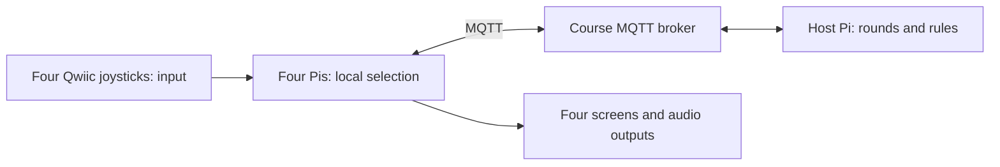

# Look Away — Lab 6 Part C

Four seats, with one solo player versus three teammates. One to four people can play, and AI fills empty seats. Secretly select a direction with a Qwiic joystick. Matching the solo player eliminates a teammate. The solo player wins by eliminating everyone; the team wins if anyone survives five rounds. Eliminated players watch until replay. Replay rotates the solo role.

The MiniPiTFT interface uses original cartoon faces, colorful menu cards,
direction-following eyes, a countdown, survivor indicators, and animated
victory confetti. Rendering is capped at 12 frames per second; test actual
display responsiveness and cue timing on the Pis. Terminal mode retains
plain text for debugging. Room entry uses fixed digit cells with an aligned caret.

Once all choices lock, every screen shows a four-player answer board during
the ready-to-reveal sequence. P1–P4 follow lobby join order; SOLO marks the
current solo player and a white border marks your seat. During READY, faces look straight ahead and choices stay hidden. At the reveal
cue, pupils animate toward each chosen direction over 0.4 seconds and direction
labels appear. After 1.4 seconds, matching players switch to X eyes with the
elimination sound. Players eliminated in previous rounds remain OUT. The board stays visible for
six seconds after that cue, including on the final round, before advancing
to the next round or the victory screen.

## Install and run

Obtain this folder on each Pi. Until merged upstream, fetch the author's branch or copy `Lab 6/look-away/` into your checkout. After upstream merge, pull upstream into your fork. No other project folder is required at runtime.

Use the existing Lab 2 display wiring (CS GPIO5, DC GPIO25, backlight GPIO22), joystick on I2C, and configured audio output. Enable SPI/I2C as in previous labs. Leave the joystick centered during startup to calibrate its center.

```bash
cd 'Lab 6/look-away'
python3 -m venv --system-site-packages .venv
source .venv/bin/activate
pip install -r requirements.txt
sudo systemctl stop piscreen.service
python play.py
```

Choose Host or Join using the joystick and click to confirm. The host receives a four-digit room code. Joining players select digits with up/down, move with left/right, then click. Once all human players have joined, the host clicks to start; AI players fill any empty seats. One to four humans can play, including the host. Host clicks after the result to replay. Ctrl-C exits. Start only one host per room; choose a different code if using `--host --room 1234` near another group.

Move in a direction once to select it; returning to center preserves the choice. Changes are allowed until the countdown ends. If no direction was selected, select one when prompted; the result waits for every active player. A disconnect pauses the game; reconnecting restarts the interrupted round. Keep the same process running to preserve player identity. A host failure requires restarting the programs and creating a new room.

### Joystick calibration (only if directions are inverted)

Keep the joystick centered when starting any game. If a physical direction
shows the opposite direction on screen, exit the game and run:

```bash
python play.py --calibrate
```

1. Start with the joystick centered.
2. Follow the screen prompt to hold **RIGHT**.
3. Release to center when prompted, then hold **UP**.
4. After “Calibration saved,” restart with `python play.py`.

Calibration learns both axis orientations and is saved locally in
`joystick.json`, which Git ignores. Each Pi only needs this once if its
directions are inverted; repeat if the joystick is rotated or replaced.

### Audio test and silent-speaker troubleshooting

Run the sound test before joining a room:

```bash
python play.py --audio-test
```

You should hear the countdown, reveal, elimination, and victory tones in order.
The command also lists available SDL output devices. To choose a specific device,
copy its exact name from that list:

```bash
python play.py --audio-test --audio-device 'UACDemoV1.0 Analog Stereo'
python play.py --audio-device 'UACDemoV1.0 Analog Stereo'
```

If the test prints “Playing” but stays silent, check the selected output,
volume, and mute status. Mixer initialization alone does not confirm that
the speaker is audible. On the class Pi's PipeWire/PulseAudio setup:

```bash
pactl get-default-sink
pactl get-sink-mute @DEFAULT_SINK@
pactl get-sink-volume @DEFAULT_SINK@
aplay -l
```

If muted or at 0%, unmute and set a moderate volume, then rerun the test:

```bash
pactl set-sink-mute @DEFAULT_SINK@ 0
pactl set-sink-volume @DEFAULT_SINK@ 40%
python play.py --audio-test
```

Also check the speaker connection and any physical volume control. The game
uses the system default output unless `--audio-device` is supplied; retain
that option when launching a real or simulated game. `--mute` disables sound
for diagnostics. The generated WAV tones in `assets/` are original project assets.

To remove, exit and delete this folder, including its `.venv`. Restore the ordinary display with `sudo systemctl start piscreen.service`. The virtual environment can use system-installed Pi hardware libraries but game dependencies are installed locally.

## Architecture



The host is also a player. It owns rounds, accepted choices, eliminations and wins. Clients read sensors and render state locally. Room messages use `IDD/look-away/<four-digit-code>/`:

| Topic | Payload / purpose |
| --- | --- |
| `hello` | Player ID and nonce; join and one-second heartbeat |
| `pong` | Player, nonce, host monotonic time and session ID; estimate clock offset |
| `reject` | Player and reason for unsuccessful join |
| `choice` | Session, player, round revision and locked direction |
| `state` | Session, authoritative state and paused flag, every 100 ms |

Messages are JSON, QoS 1, never retained. Round revisions reject stale inputs and duplicate choices are ignored. Choices are excluded from snapshots until the reveal phase; clients delay displaying them until the scheduled reveal. This is a cooperative classroom game, not a secure anti-cheat protocol. Separate room topics isolate groups. The course broker defaults match the Lab 6 instructions; override with `--broker`, `--port`, `LOOK_AWAY_USER`, and `LOOK_AWAY_PASSWORD` if needed.

Clients estimate host clock offset from heartbeat round trips. Countdown tones are scheduled before their deadlines; reveal/results have two seconds of lead time. Audio is locally preloaded. Network jitter and audio device latency still require measurement on the four actual Pis. Missed old cues are skipped rather than played in a burst.

## Verification

For solo practice on your Pi, run `python play.py --simulate --room 6278`.
This starts you as host and fills the other three seats with local bots.
Click the joystick to start; bots choose random directions at the deadline.
Replay rotates the solo role, including to bots. The normal MQTT broker is
still required. Bots exercise the game rules, not separate network clients
or four-device audio synchronization. Restart without `--simulate` for real players.

```bash
python -m unittest -v
# Four terminals, using the same reachable broker; each requires paho-mqtt:
python play.py --terminal --mute --host --room 1234
python play.py --terminal --mute --room 1234
# Repeat the Join command in two more terminals.
```

Terminal controls: w/a/s/d then Return for directions, blank Return to click, q then Return to exit. Use separate terminals, not shared stdin. Rule tests cover four-player admission, early win, five-round survival, role rotation, missing choices, duplicate/stale inputs, and private snapshots.

Hardware/network acceptance checklist (record actual results; not yet verified):

- [ ] Four Pis join through their screens; full rooms reject a fifth player.
- [ ] All joystick arrows match physical direction; text fits and choices stay private.
- [ ] Missing selection waits; eliminated players cannot submit affecting choices.
- [ ] Hear each cue on all four devices; record audio/video and estimate playback skew. Adjust lead time or audio configuration if objectionable.
- [ ] Disconnect one client temporarily: pause, reconnect, restart interrupted round without elimination errors.
- [ ] Kill host or lose broker connectivity: clients show host loss and require a fresh session.
- [ ] Two different room codes run without cross-talk.
- [ ] Complete early solo win, five-round team win and rotating replay.

## Submission evidence — fill after building and testing

Add collaborators, photos of each Pi/joystick/screen, and a video of a complete game. Include annotated code excerpts for joystick events, MQTT choices, host adjudication and timed sound playback.

| Outside tester | Expected before playing | Observed / surprising | Requested changes | Photo/video |
| --- | --- | --- | --- | --- |
| Tester 1 | Pending | Pending | Pending | Pending |
| Tester 2 | Pending | Pending | Pending | Pending |

Reflection: What worked? Which network/timing problems occurred? How did joystick events become decisions? Why did rules run on the host and rendering/audio on each Pi? What would you improve? Record observations, including measured cue synchronization, rather than assuming success.
